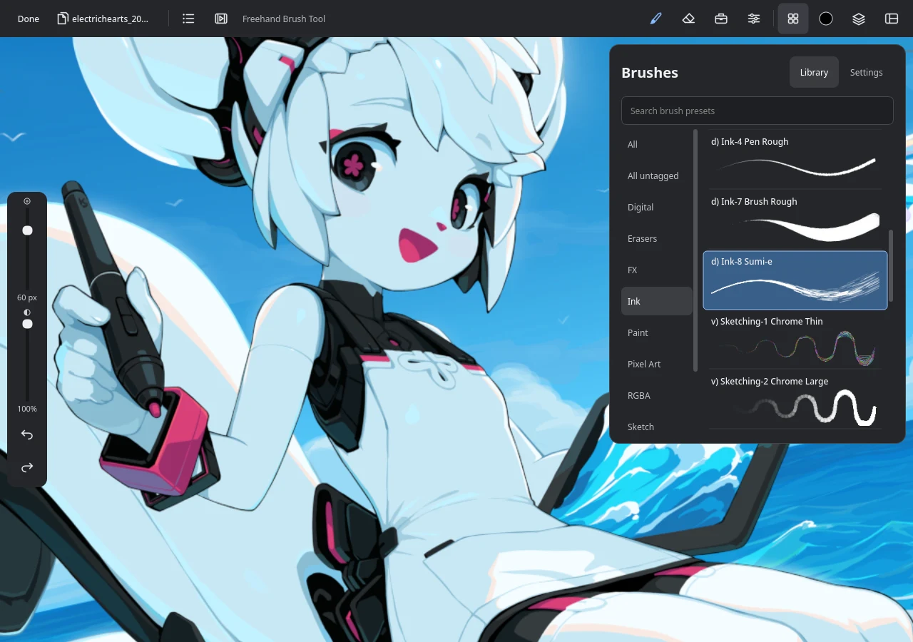

| CI Name     | Master | Stable | Release |
| ------------------- | ---------------- | ------ | ------- |
| Pipeline | [](https://invent.kde.org/graphics/krita/-/commits/master) | [](https://invent.kde.org/graphics/krita/-/commits/krita/5.2) | [](https://invent.kde.org/graphics/krita/-/releases) |

Note: Nightly builds are not covered by this table atm

Krita is a free and open source digital painting application. It is for artists who want to create professional work from start to end. Krita is used by comic book artists, illustrators, concept artists, matte and texture painters and in the digital VFX industry.

### Tablet Mode in this fork

Open a document and tap **Tablet Mode** in the File toolbar, or choose **View → Tablet Mode**. Tap **Done** to return to your desktop layout. The document button in the top bar lets you switch between open canvases while staying in Tablet Mode.



[Color panel](.github/screenshots/tablet-color.webp) · [Portrait animation filmstrip](.github/screenshots/tablet-animation.webp). Canvas artwork by Tyson Tan, from Krita’s bundled splash illustrations.

- **Paint.** The left rail puts brush size, opacity, undo and redo under your thumb. Open **Brush Presets** to browse brushstroke previews, search by name, or filter by tag. Its **Settings** tab has flow, blend mode and smoothing controls, plus a shortcut to the full Brush Editor.
- **Choose colors and manage layers.** Tap the foreground swatch for the color selector, RGB channels, hex entry and recent colors. Grayscale documents show a value ramp and neutral swatches. Open **Layers** to select a layer by thumbnail, adjust its opacity and blend mode, or group, reorder and merge layers.
- **Illustrate and edit.** **Tools** and **Actions** let you search the tools and commands registered in your Krita installation. The bottom bar changes with the active tool, putting transform modes, crop ratios, selection operations or move controls within reach. **Tool Options** opens the active tool’s full settings.
- **Animate.** Open **Animation Timeline** to choose a layer, scrub frames, toggle onion skins, add a keyframe and play the sequence. The filmstrip’s options menu includes duplicate and remove, frame rate and playback range.
- **Open a docker.** **Studio Panels** gives you searchable access to installed dockers, including plugin panels. Tap the same toolbar button again to close a panel and uncover the canvas.

If you are reading this on GitHub, be aware that this is just a mirror. Our real code repository is provided by KDE: https://invent.kde.org/graphics/krita.git


### Repository Status

For branch: `master`

| Freeze type    | Status                                                               |
|----------------|----------------------------------------------------------------------|
| Feature Freeze | features are allowed                                                 |
| String Freeze  | strings are allowed                                                  |


### User Manual
https://docs.krita.org/en/user_manual.html

### Development Notes and Build Instructions

Please follow [the online documentation](https://docs.krita.org/en/untranslatable_pages/building_krita.html).

Other developer guides, notes and wiki:

https://docs.krita.org/en/untranslatable_pages.html

Apidox:

https://api.kde.org/legacy/krita/html/index.html

### Bugs and Wishes

https://bugs.kde.org/buglist.cgi?bug_status=UNCONFIRMED&bug_status=CONFIRMED&bug_status=ASSIGNED&bug_status=REOPENED&list_id=1315444&product=krita&query_format=advanced

### Discussion Forum

* https://krita-artists.org/

### IRC channel

Most of the developers hang out here. If you are interested in helping with the project this is a great place to start.

libera.chat, #krita

### Project Website

https://www.krita.org

### Nightly builds

#### Unstable

* https://cdn.kde.org/ci-builds/graphics/krita/master/

#### Stable

* https://cdn.kde.org/ci-builds/graphics/krita/krita-5.2/

#### Developers builds

##### Linux build with debug symbols in Qt and Krita

1) Go to Jobs section of Krita's CI: https://invent.kde.org/graphics/krita/-/jobs
2) Search for the latest `linux-debug-weekly` job
3) Enter the job and click on Artifacts->Browse
4) Download the AppImage

##### Linux build with ASAN in Qt and Krita

1) Go to Jobs section of Krita's CI: https://invent.kde.org/graphics/krita/-/jobs
2) Search for the latest `linux-asan-weekly` job
3) Enter the job and click on Artifacts->Browse
4) Download the AppImage
5) Set up environment variable for ASAN:
    ```bash
        export ASAN_OPTIONS=new_delete_type_mismatch=0:detect_leaks=0
    ```
6) Run the AppImage in the modified environment

##### Windows build with ASAN in Qt and Krita

1) Go to Jobs section of Krita's CI: https://invent.kde.org/graphics/krita/-/jobs
2) Search for the latest `windows-asan-weekly` job
3) Enter the job and click on Artifacts->Browse
4) Download the .zip file
5) Open terminal
6) Set up environment variable for ASAN:
    ```
        set ASAN_OPTIONS=new_delete_type_mismatch=0:detect_leaks=0
    ```
7) Change working directory to `c:\path\where\you\downloaded\krita-5.3.0-prealpha-git12345\bin`.
   That is important, otherwise ASAN will not be able to locate llvm-symbolizer.exe and the
   backtraces generated by ASAN will not contain proper symbols.
    ```
        cd c:\path\where\you\downloaded\krita-5.3.0-prealpha-git12345\bin
    ```
8) Run krita
    ```
        krita.com
    ```

### License

Krita as a whole is licensed under the GNU Public License, Version 3. Individual files may have a different, but compatible license.

### AI Moratorium

Since the Krita developer community cannot currently find consensus on whether the use of AI tools to assist development is acceptable or not, we have decided to put a moratorium on the use of these tools until October 2026. 

The reason for pushing this off to October are:

1) if we'd allow the use of AI in development right now, the backlash from our users and supporters will be furious.
2) KDE as a whole does not have a policy in place, and if our policy would conflict with KDE's we'd potentially have to revert contributions made with AI
3) The development of AI itself might change for the better or the worse in the next period. Microsoft is already backtracking from their CoPilot brand. Acceptance of AI can change for better or worse. The environmental impact of AI could lessen.

Until we make a decision, the use of AI when working on Krita is not allowed.
